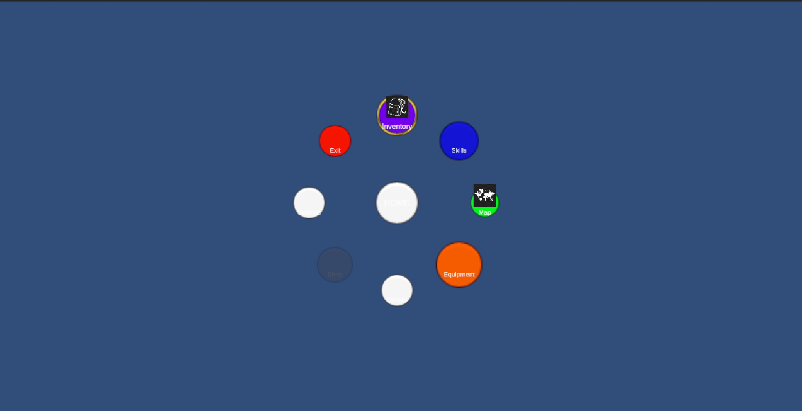
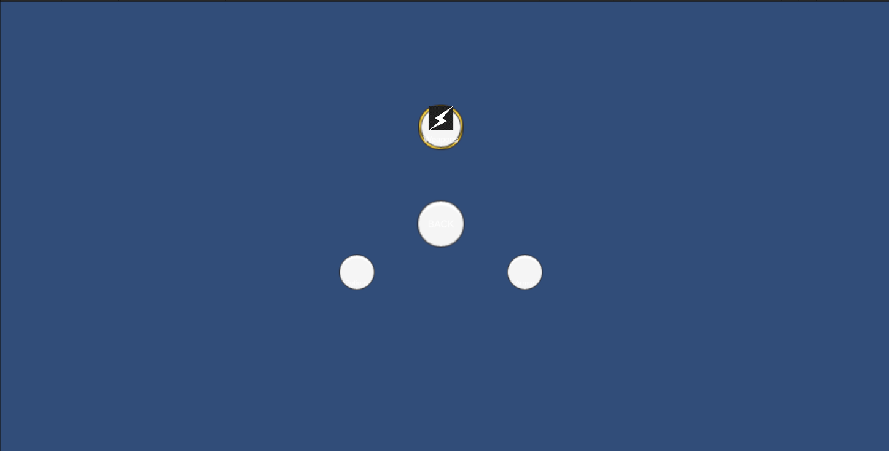
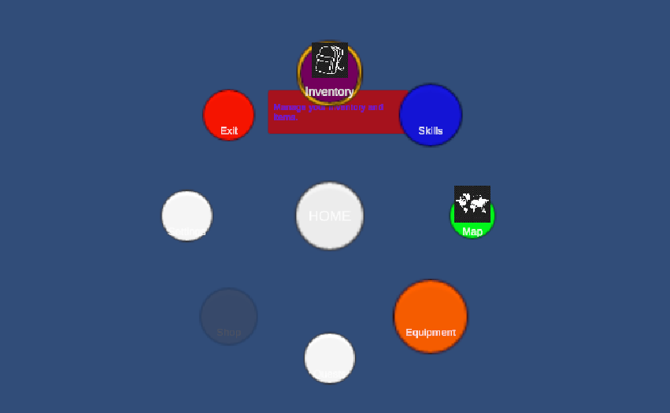

# Unity Multi-Level Radial Menu

A reusable, data-driven multi-level radial menu framework for Unity.

Build hierarchical radial menus with mouse and keyboard interaction, smooth animations, tooltips, and runtime menu management.
## Screenshots

### Main Menu



### Multi-Level Navigation



### Tooltip and Interaction


## Features

- Data-driven menu structure using ScriptableObject
- Multi-level menu navigation
- Circular menu item layout
- Mouse hover and click interactions
- Keyboard navigation
- Disabled menu items
- Center button navigation
- Smooth menu transitions and animations
- Selection highlighting and scaling
- Tooltip with fade animation
- Audio feedback
- Runtime menu item management
- Menu data validation
- Reusable Prefab-based architecture

## Requirements

- Unity 2022.3.62f3c1
- TextMeshPro
- Unity UI

## Installation

1. Download or clone this repository.
2. Open the project in Unity.
3. Locate `RadialMenuRoot_Template.prefab` in the Prefabs folder.
4. Drag the Prefab into a Canvas.
5. Create a RadialMenuData asset.
6. Assign the data asset to the Menu Data field.
7. Configure the required UI references.
8. Enter Play Mode.

## Creating Menu Data

1. Right-click in the Project window.
2. Select `Create → Radial Menu → Menu Data`.
3. Configure the root node and its children.
4. Set menu names, descriptions, icons, colors, and item sizes.
5. Assign the data asset to RadialMenuController.

## Controls

| Input | Action |
|---|---|
| Mouse Hover | Select a menu item |
| Left Click | Activate a menu item |
| Arrow Keys | Navigate between items |
| Enter | Confirm selection |
| Escape | Return to the previous menu |

## Runtime API

The framework supports runtime menu operations:

- `AddMenuItem`
- `RemoveMenuItem`
- `UpdateMenuItem`

Refer to `RadialMenuController.cs` for method signatures and usage examples.

## Project Structure

```text
Assets/
├── Scripts/
│   ├── RadialMenuController.cs
│   ├── RadialMenuNode.cs
│   └── RadialMenuData.cs
├── Prefabs/
├── Demo/
│   ├── Data/
│   ├── Tests/
│   └── Legacy/
├── Scenes/
├── Art/
└── Documentation/
```

## Demo

The project includes demo scenes and sample menu data to help you get started.

## License

This project is licensed under the MIT License. See the `LICENSE` file for details.


